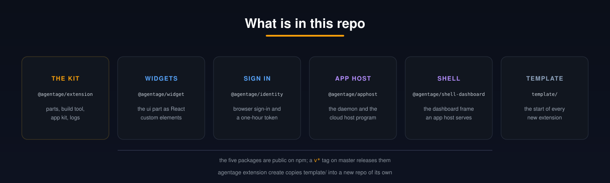

# agentage kit


The kit is the library that every agentage extension is built on. An extension is one npm package
that adds pages, an app, widgets, an API, MCP tools, jobs or terminal commands to agentage. You
write each part as one `create(ctx)` function; the kit owns the server, `/health`, auth, the store
and the images. This repo is for extension authors and for the people who work on the kit.

Status: before 1.0. Extensions built on the kit run on the staging estate "next"
(`*.next.agentage.io`). You need Node 22 or newer, npm 10 or newer and git.

## Quick start

Make a new extension from the template in this repo and check it:

```bash
npx @agentage/cli@latest extension create my-ext --no-install
cd extension-my-ext && npm ci
npm run verify
npx agentage extension check   # PASS my-ext 0.1.2 conforms (6 rules)
```

`--no-install` only makes the folder. Without it, `create` also runs the new extension on the
local daemon (`127.0.0.1:4243`). The guide of the new folder is its own `README.md`.

## What is in this repo



| Path                       | npm package                 | What it is                                                     |
| -------------------------- | --------------------------- | -------------------------------------------------------------- |
| `packages/extension`       | `@agentage/extension`       | The kit: parts, the build tool, the app kit, the event line    |
| `packages/widget`          | `@agentage/widget`          | The `ui` part: React widgets as custom elements                |
| `packages/identity`        | `@agentage/identity`        | Sign-in and a one-hour part token for a browser page           |
| `packages/apphost`         | `@agentage/apphost`         | The app host program: the local daemon and the cloud host      |
| `packages/shell-dashboard` | `@agentage/shell-dashboard` | The dashboard shell that an app host serves at `/`             |
| `packages/app`, `logs`     | private                     | Built into `@agentage/extension` (`/app`, `/logs`)             |
| `template/`                | not on npm                  | The start of every new extension, copied by `extension create` |
| `docs/`                    | -                           | The parts, the tool, the part image, the daemon, the release   |

Words: a **part** is one folder of an extension (`pages`, `app`, `ui`, `api`, `mcp`, `worker`,
`cli`, and `store` with no code folder). An **app host** runs extensions: the daemon on your
machine, or a cloud host. The **probe** extension in
[agentage/examples](https://github.com/agentage/examples) has one part of every kind.

## How to work on it

```bash
npm ci
npm run verify                    # type-check, lint, format:check, test with coverage, build
npx vitest run packages/identity  # the tests of one package
npm run test:e2e                  # the widget harness in Chromium
```

`npm run test:e2e -w @agentage/shell-dashboard` checks the dashboard shell in Chromium. The
`template/` folder is not a workspace: it has its own lock and its own CI jobs (`Template`).

## How a change is released

A merge to master releases nothing. A `v<version>` tag on master runs
`.github/workflows/release.yml`: it runs `verify`, publishes each package version that is not on
npm yet (OIDC trusted publishing, with provenance), and pushes the app host image
`ghcr.io/agentage/platform/apphost:<version>`. A change in `README.md`, `docs/` or a package
README ships on npm only with the next tag. Details and what to do when a run fails:
[docs/release.md](docs/release.md).

An extension made from `template/` releases differently: each merge to its master is a release,
with a date version such as `2026.1122.1`.

## For agents

- Read [AGENTS.md](AGENTS.md) (the same file as `CLAUDE.md`): commands, layout, rules and where each fact lives.
- Required checks: `Verify`, `Widget screenshots`, `Probe local gate on this kit`, `Image smokes`, `Template`.
- Never publish to npm by hand, never push a `v*` tag unless the owner asks, and in automation never run `extension create` without `--no-install`.

## Links

- [docs/parts.md](docs/parts.md), [docs/tool.md](docs/tool.md),
  [docs/part-image.md](docs/part-image.md), [docs/daemon.md](docs/daemon.md),
  [docs/release.md](docs/release.md).
- [agentage/cli](https://github.com/agentage/cli): the `agentage` command (`@agentage/cli`).
- [agentage/examples](https://github.com/agentage/examples): the probe and fixture extensions.
- [agentage.io](https://agentage.io): the product.

## License

MIT. See [LICENSE](LICENSE).
