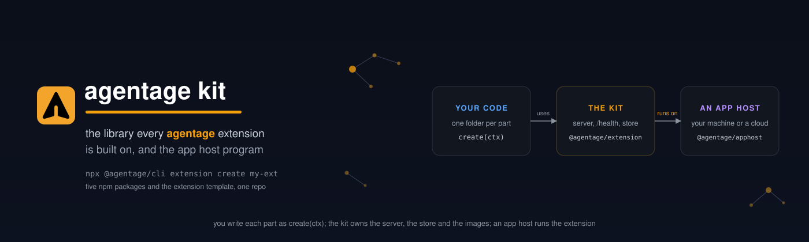

# @agentage/identity



The identity client for an agentage browser page. It signs the user in at auth, gives the page a
one-hour token for the extension parts, and signs out. It runs in the page.

```bash
npm install @agentage/identity
```

```ts
import { createIdentity } from '@agentage/identity';

const id = createIdentity({
  authUrl: 'https://auth.agentage.io',
  scopes: ['probe:read'],
});

await id.signIn(); // auth's sign-in page, then back to this page
const token = id.token(); // a TokenSource for createBridge({ token })
await id.signOut(); // revokes the token, then ends the session
```

`scopes` is required. A failed call throws an `IdentityError` with `code`, `message` and `status`.
The client never logs a token.

- Each method, `mintToken`, `revokeToken` and the test options:
  [docs/identity.md](https://github.com/agentage/kit/blob/master/docs/identity.md).
- The whole kit: the [kit README](https://github.com/agentage/kit#readme).

License: MIT
